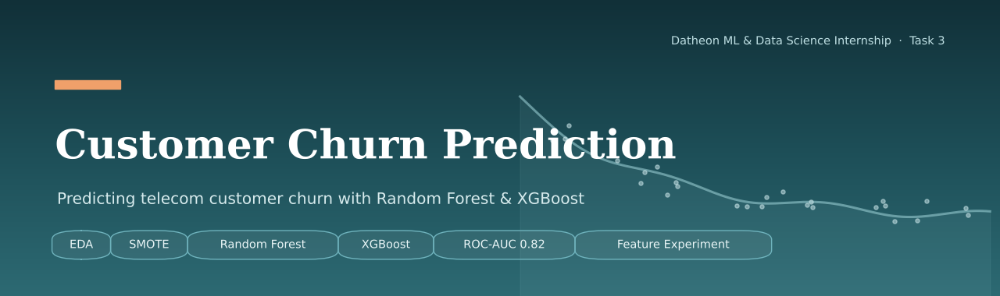
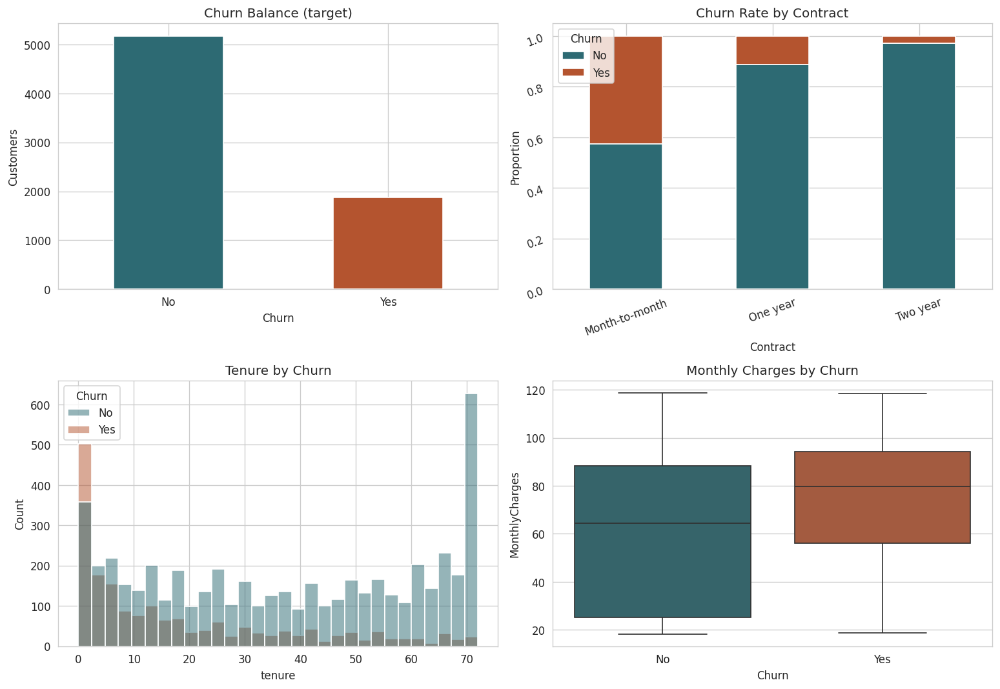
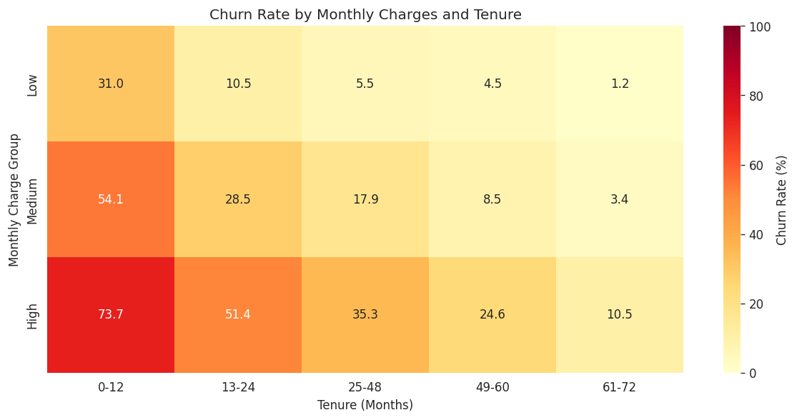
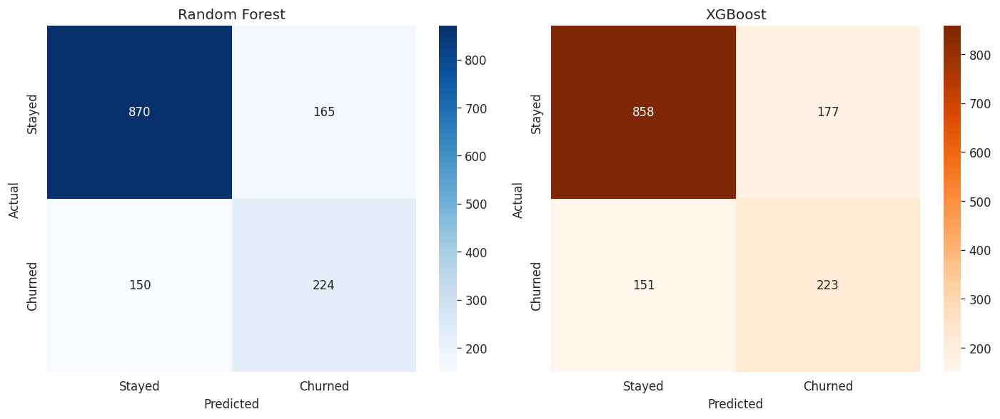
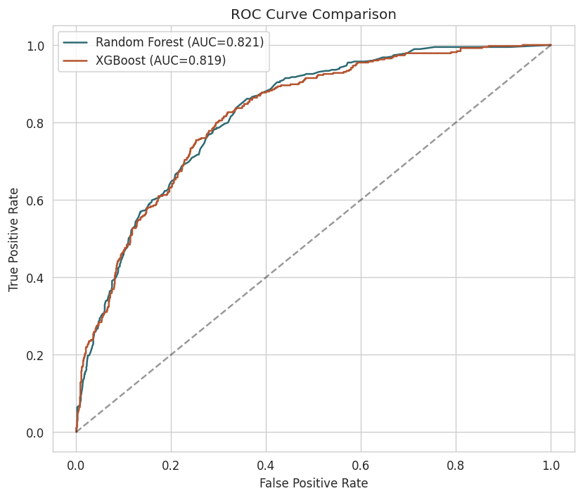
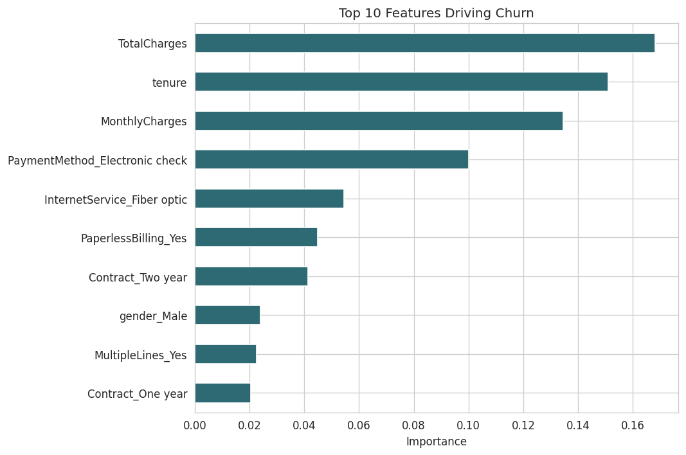
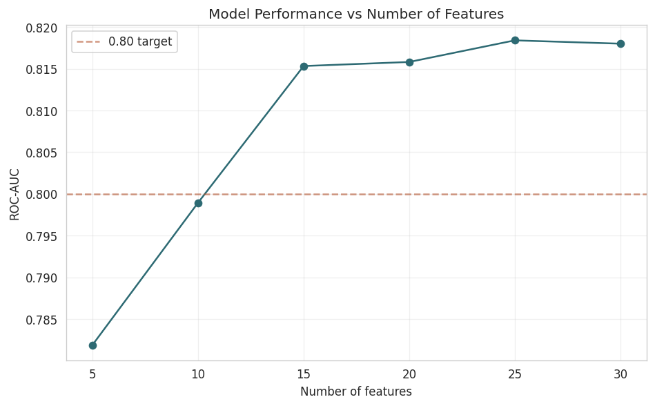

# Customer Churn Prediction

**Datheon Machine Learning & Data Science Internship — Task 3**
Author: **Ansuman Jaiswal** ([@iam-ansuman](https://github.com/iam-ansuman))


A supervised machine learning project that predicts which telecom customers are likely to churn, so the business can step in and retain them before they leave. Built end to end: exploratory analysis, data cleaning, class balancing with SMOTE, two ensemble models, honest evaluation, and a self-driven feature experiment that goes beyond the original brief.

---

## Business Problem

A telecom company loses revenue every time a customer leaves. Winning a new customer costs far more than keeping an existing one, so the company wants to know **in advance** which customers are at risk of leaving, and **why**, so retention effort can be targeted where it matters.

- **Business question:** Which customers are likely to churn, and what drives it?
- **Data science task:** Supervised binary classification (Churn = Yes / No).
- **Success metric:** ROC-AUC above 0.80 on an unseen test set.

## Dataset

Telco Customer Churn dataset: **7,043 customers, 21 columns.** Each row is one customer, described by demographics, the services they subscribe to, their contract and billing setup, and whether they churned. The target is imbalanced: about **27% churned, 73% stayed.**

---

## Project Workflow

This project follows a complete, repeatable ML workflow:

1. Business Understanding
2. Data Understanding (EDA)
3. Data Preparation
4. Train / Test Split
5. Handling Class Imbalance (SMOTE)
6. Modeling (Random Forest & XGBoost)
7. Evaluation
8. Interpretation & Feature Experiment
9. Communication & Business Recommendations

---

## 1. Exploratory Data Analysis



The exploratory analysis suggests that the company may face challenges in retaining new customers, particularly those in the higher monthly-charge group. Churn rates are considerably higher among customers with shorter tenure and decrease as tenure increases. This may indicate that the initial customer experience, pricing, or perceived value could influence retention. In contrast, customers with longer tenure may have established relationships with the company and may be more accustomed to its services. However, further analysis of customer satisfaction, contract type, and other factors is needed before concluding that the company has an ineffective retention strategy.

Key patterns observed:

- **Contract type is the strongest single signal.** Month-to-month customers churn around 42%; one-year drops to roughly 11%; two-year is almost negligible.
- **New customers churn most.** Churn is concentrated in the first year of tenure and falls sharply afterwards.
- **Higher monthly charges are associated with higher churn.**

### Interaction effect: tenure x monthly charges



To test whether two factors combine, I grouped customers by tenure band and monthly-charge band and measured the churn rate in each cell. The result confirms an **interaction**: new customers who also pay high charges are the single most at-risk group, far more than either factor alone would suggest. This insight shaped the business recommendations.

---

## 2. Data Preparation

- **Fixed `TotalCharges`:** stored as text with 11 blank values for brand-new customers (tenure 0). Converted to numeric and filled those 11 with 0.
- **Dropped `customerID`:** an identifier with no predictive value.
- **Encoded the target:** Churn Yes = 1, No = 0.
- **One-hot encoded** all categorical features, expanding 20 columns to 30 numeric features without imposing a false order on the categories.

## 3. Train / Test Split

An **80/20 split**, stratified on Churn so both sets keep the real ~27% churn ratio, with `random_state=42` for reproducibility. The test set was held out **before any balancing**, so it stays a realistic sample and no information leaks from test into training.

## 4. Handling Class Imbalance (SMOTE)

The target is imbalanced, so training directly would bias the model toward predicting "no churn." **SMOTE** was applied to **the training set only** to synthesise minority-class (churner) examples until the classes were balanced.

| Stage | Stayed | Churned |
|-------|--------|---------|
| Before SMOTE | 4,139 | 1,495 |
| After SMOTE | 4,139 | 4,139 |

The test set was never balanced, so evaluation reflects the real world.

---

## 5. Modeling & Results

Two ensemble models were trained on the SMOTE-balanced training data and evaluated on the untouched test set.

| Model | ROC-AUC | Churn Recall | Churn Precision |
|-------|:-------:|:------------:|:---------------:|
| **Random Forest** (final) | **0.821** | 0.60 | 0.58 |
| XGBoost | 0.819 | 0.60 | 0.56 |

Both models cleared the 0.80 target. Random Forest performed marginally better, so it was chosen as the final model. The two models were close enough that the difference is within noise, which is reported honestly rather than overstated.

### Evaluation





The final model catches about **60% of real churners** in the test set. Since the cost of a retention offer is far lower than the cost of losing a customer, recall was prioritised over precision; some false alarms are an acceptable trade-off.

---

## 6. Interpretation



The most influential features align with the EDA: **tenure, total and monthly charges, electronic-check payment, fiber-optic internet, and contract type.** The model's view of what matters matches the human-readable patterns, which builds confidence in the result.

---

## Beyond the Brief: Feature Experiment

> The task only asked for a prediction model. As a data scientist, I wanted to go further and test a hypothesis: **do we really need all 30 features, or can a leaner model do nearly as well?**



I trained the model on the top 5, 10, 15, 20, 25, and 30 ranked features and compared ROC-AUC:

| Features | ROC-AUC |
|:--------:|:-------:|
| 5 | 0.782 |
| 10 | 0.799 |
| 15 | 0.815 |
| 20 | 0.818 |
| 30 | 0.821 |

**Finding:** performance rises steeply up to about 15 features, then flattens. The model reaches roughly 98% of its full performance with only half the features. This demonstrates the trade-off between model simplicity and accuracy: a 15-feature model is simpler and easier to explain, at a very small cost in score. The full 30-feature model was kept as the final version for maximum performance, with this experiment documented as supporting analysis.

---

## Business Recommendations

1. **Target new customers in their first year** with onboarding and early check-ins; this is the highest-risk window.
2. **Move month-to-month customers onto annual contracts** with incentives; contract length is the strongest protective factor.
3. **Investigate the electronic-check and fiber-optic segments** for pricing or service-quality issues.
4. **Focus retention budget on high-charge, low-tenure customers**, the group the interaction analysis flagged as most at risk.

---

## Tech Stack

`Python` · `pandas` · `NumPy` · `scikit-learn` · `imbalanced-learn (SMOTE)` · `XGBoost` · `Matplotlib` · `Seaborn`

## Repository Structure

```
Task-3-Customer-Churn-Prediction/
├── churn_prediction.ipynb      # full notebook: EDA -> modeling -> evaluation
├── Telco-Customer-Churn.csv     # dataset
├── churn_images/                # all generated charts
└── README.md
```

## How to Run

1. Open `churn_prediction.ipynb` in Google Colab or Jupyter.
2. Upload `Telco-Customer-Churn.csv` to the working directory.
3. Run all cells (`pip install xgboost imbalanced-learn` if needed).

---

*Built by Ansuman Jaiswal as part of the Datheon Machine Learning & Data Science Internship.*
